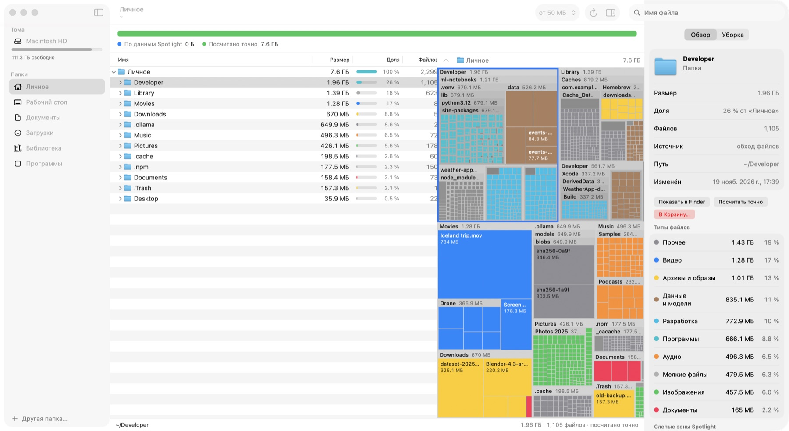

# DiskSpot

Анализатор места на диске для macOS 15+: быстрая оценка по индексу Spotlight плюс точный обход того, чего Spotlight не видит. Карта занятого места, дерево с долями, типы файлов и инспектор. Тот же сканер доступен агентам через MCP-сервер `diskspotmcp`.



## Быстрый старт

```sh
git clone git@github.com:kpeeem/DiskSpot.git
```

```sh
cd DiskSpot && ./build.sh
```

```sh
open build/DiskSpot.app
```

Нужны Xcode и `xcodegen` (`brew install xcodegen`). `build.sh` подписывает приложение первым сертификатом из Связки ключей, поэтому «Полный доступ к диску» сохраняется между пересборками; без этого доступа часть `~/Library`, Рабочий стол, Документы и Загрузки скрыты и от Spotlight, и от обхода.

MCP-сервер для Claude Code:

```sh
./build-mcp.sh
```

```sh
claude mcp add --scope user diskspot "$PWD/build/diskspotmcp"
```

## Как считается

1. **Spotlight.** Запрос `kMDItemPhysicalSize` по индексу возвращает крупные файлы и пакеты за секунды, размеры папок собираются по путям.
2. **Слепые зоны.** Места, которые Spotlight не индексирует (исключения, системные и служебные папки), обходятся точно.
3. **Точный обход.** Общая очередь папок: свободные потоки забирают поддеревья, до которых занятые ещё не дошли, поэтому том с одной огромной домашней папкой не упирается в один поток. Записи читаются пакетами через `getattrlistbulk` (если папка отказывает — через `readdir`), блоки считаются как у `du`, hard links один раз, точки монтирования не пересекаются, выгруженные в iCloud файлы и папки не скачиваются. Во время обхода хранятся только папки и файлы крупнее порога, свёрнутое дерево строится снизу вверх.

| Что сканировалось (под нагрузкой) | Файлов | Прежний обход | Очередь папок |
|---|---:|---:|---:|
| `/Applications/Xcode.app/Contents/Developer` | 126 457 | 1,0–1,8 с | 0,4–0,8 с |
| `~/Dev` | 3,5 млн | 34,5 с | 28,7 с |
| `/System/Volumes/Data` целиком | 9,2 млн | 232 с | 137 с |

На неизменных деревьях итоги и свёрнутое дерево совпадают с прежним сканером до байта.

## MCP

| Инструмент | Что делает |
|---|---|
| `disk_volumes`, `disk_status` | тома, занято, свободно, purgeable; системные APFS-тома; доступ и исключения Spotlight |
| `disk_tree`, `disk_top` | точное дерево и самые тяжёлые папки и файлы под путём |
| `disk_big_files`, `disk_recent` | крупные файлы и то, что записано за последние дни, прямо из индекса Spotlight |
| `disk_snapshot`, `disk_diff`, `disk_snapshot_forget` | сохранить замер и посмотреть, что выросло, появилось или пропало с тех пор |

Весь загрузочный том — это `/System/Volumes/Data`: `/` — запечатанный системный том, а обход не пересекает точки монтирования.

## Отладка

Отладочная сборка фотографирует собственное окно и пишет журнал скана:

```sh
./build.sh Debug
```

```sh
open -n --env DISKSPOT_FOLDER=/Applications --env DISKSPOT_SNAPSHOT=/tmp/diskspot --env DISKSPOT_NO_SHEET=1 --stderr /tmp/diskspot.log build/DiskSpot-Debug.app
```

`DISKSPOT_FOLDER` сразу открывает папку, `DISKSPOT_EXACT`, `DISKSPOT_ZOOM`, `DISKSPOT_SELECT` и `DISKSPOT_PROBE` запускают точный обход, приближение, выделение и проверку сканера.
