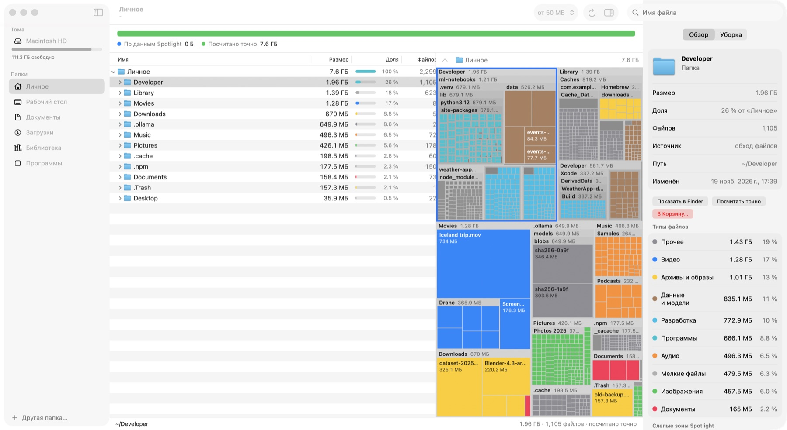
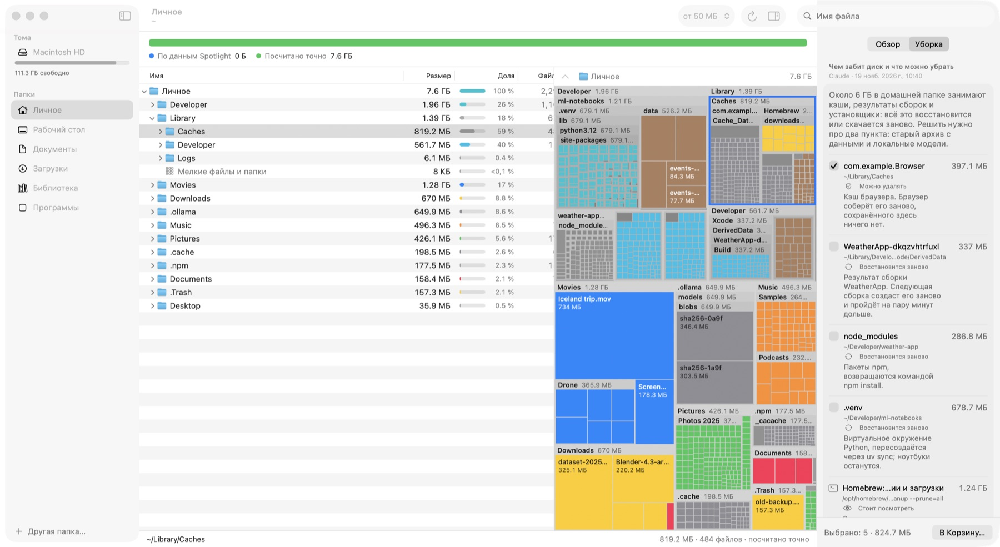

# DiskSpot

[](https://github.com/kpeeem/DiskSpot/releases/latest)
[](LICENSE)


[English](README.md) · Русский

> **TL;DR** — анализатор места на диске на SwiftUI: за секунды отвечает по индексу Spotlight и точно обходит только то, чего Spotlight не видит. Карта, дерево с долями, типы файлов, вкладка уборки и MCP-сервер, через который Claude меряет диск и присылает советы прямо в приложение.



## Установка

1. Скачайте `DiskSpot-*.zip` со страницы [Releases](https://github.com/kpeeem/DiskSpot/releases/latest) и перенесите приложение в «Программы».
2. Сборка не нотаризована. При первом запуске откройте **Системные настройки → Конфиденциальность и безопасность → Всё равно открыть** или выполните:

```sh
xattr -dr com.apple.quarantine /Applications/DiskSpot.app
```

3. Дайте **Полный доступ к диску**: без него Рабочий стол, Документы, Загрузки и части Library скрыты и от Spotlight, и от обхода.

Сборка из исходников (Xcode и `brew install xcodegen`):

```sh
git clone https://github.com/kpeeem/DiskSpot.git && cd DiskSpot && ./build.sh && open build/DiskSpot.app
```

## Что умеет

- **Сначала Spotlight.** Крупные файлы и пакеты приходят из индекса за секунды, слепые зоны обходятся точно.
- **Точно, когда нужно.** Параллельный обход через `getattrlistbulk` считает как `du`: весь том данных, 9 млн файлов, примерно за две минуты.
- **Рост со временем.** Снимки и сравнения показывают, что выросло с прошлого раза.
- **Уборка.** Советы Claude плюс кэши, журналы, DerivedData и кэши пакетов, которые DiskSpot меряет сам.



## Спросите Claude, что почистить

```sh
./build-mcp.sh && claude mcp add --scope user diskspot "$PWD/build/diskspotmcp"
```

Дальше спросите *«чем забился диск в последнее время, что можно удалить?»*. Claude отвечает по `disk_recent`, `disk_top` и `disk_system` и присылает каждую находку с вердиктом и объяснением. Вы отмечаете, что убрать, Claude видит, что вы решили. Советы общие с [Disk Inventory](https://github.com/kpeeem/DiskInventory).

> [!IMPORTANT]
> Агент ничего не удаляет сам. Пути уходят в Корзину только после подтверждения. Команды берутся из закрытого списка (`brew cleanup`, `simctl delete`, `docker prune`…), перед запуском приложение показывает точную команду. `/System`, `/usr` и системные настройки отклоняются.

Подробнее: [как считается, инструменты MCP, замеры, отладка](Docs/details.ru.md)

## Лицензия

[MIT](LICENSE)
